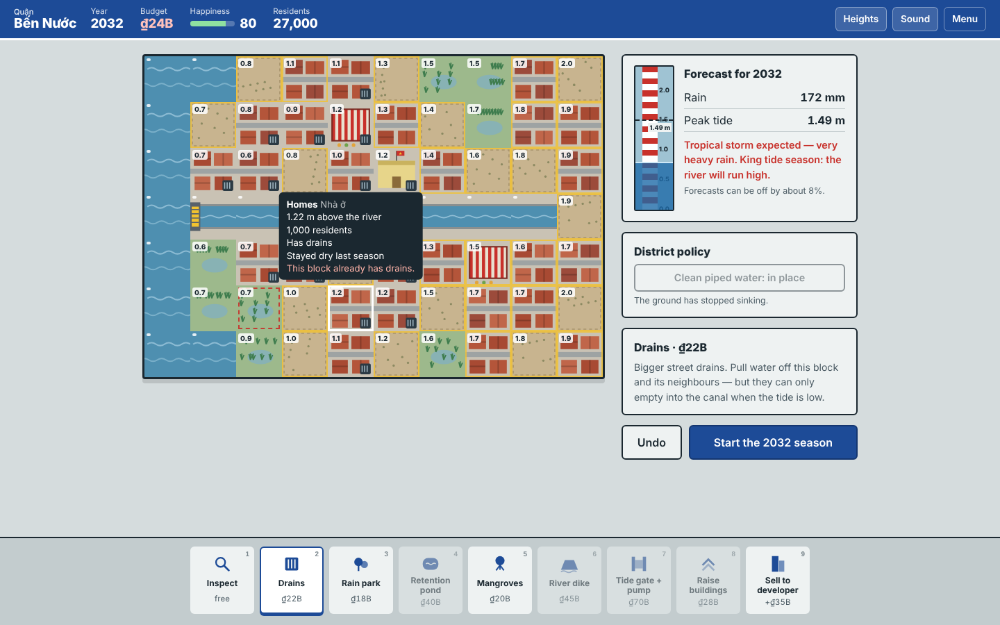

# Saigon Rising

*A turn-based planning game about keeping a riverside district of Hồ Chí Minh City dry from 2026 to 2050.*

RMIT Hackathon 2025 — Challenge 3: Vibe Coding, Play to Impact · Team **Quadcore**



## The idea

Nearly half of Hồ Chí Minh City sits less than a metre above sea level, and parts of it are sinking by several centimetres a year. Every rainy season, heavy rain meets high tides and the streets flood.

In **Saigon Rising** you are the planner for Bến Nước, an imaginary district on the bank of the Saigon River. Every two years the rainy season arrives. You read the forecast, spend a limited budget on flood defences, and watch rain and tide play out on the map. The question the game asks is the one real planners face: *what actually keeps people dry, and what only looks like it does?*

## How to run

No installation, build step or server is needed.

1. Download or clone this repository.
2. Open `game_app/index.html` in Chrome, Edge, Firefox or Safari.

The game works offline. With an internet connection it also loads the *Be Vietnam Pro* typeface from Google Fonts; without one it falls back to the system font.

## How to play

1. **Read the forecast.** It shows the rain and the peak tide, marked on the tide gauge beside the map.
2. **Build.** Choose a tool from the tray (or press `1`–`9`) and click a block. Hover over any block to see how high it sits above the river and whether you can build there.
3. **Start the season.** Rain falls, the tide pushes in from the river and up the canal, and water runs downhill. Any block under more than 15 cm of water is flooded.
4. **Read the report.** Flooded homes cost repairs and lower happiness. If happiness reaches zero, the city replaces you.

After 12 seasons (2026 to 2050) you get a grade from A to F based on the share of residents who stayed dry.

| Tool | Cost | What it does |
|---|---|---|
| Drains | ₫22B | Pull water off a block and its neighbours — but only as fast as the outlets allow at high tide |
| Rain park | ₫18B | Turns an empty lot into ground that soaks up rain |
| Retention pond | ₫40B | Stores a lot of water from surrounding blocks |
| Mangroves | ₫20B | Slow the tide on the riverbank |
| River dike | ₫45B | Blocks the tide, but also traps rainwater behind it |
| Tide gate + pump | ₫70B | At the canal mouth: stops the tide entering the canal and keeps drains working |
| Raise buildings | ₫28B | Lifts a home, the market or the school by 40 cm |
| Sell to developer | earns ₫35B | Money now, but apartments shed almost all their rain |
| Clean piped water (policy) | ₫90B | Stops groundwater pumping, so the land stops sinking |

Keyboard: `1`–`9` choose tools, `H` shows block heights, `Z` undoes the last build this season.

## What players learn

The mechanics are built around five real causes of flooding in the city:

- **King tides block drainage.** Drains are useless if their outlets are underwater, which is why the tide gate matters more than any number of drains.
- **The land is sinking.** Every season without the clean-water policy, the whole district drops 4 cm and the tide reaches further.
- **Concrete sheds rain.** Selling wetlands to developers pays well and floods the neighbours.
- **Walls cut both ways.** Dikes stop the river but turn neighbourhoods into bathtubs without drains.
- **Sponge-city design works.** Ponds, parks and mangroves hold water away from homes.

Each season report ends with a short, sourced fact about flooding in Hồ Chí Minh City. Sources are listed in `project_report.pdf`.
We have also learnt that we need to understand the fundamentals of coding before using vibe coding for the best and satisfactory results.

## Technology

- HTML, CSS and plain JavaScript only — no frameworks, no backend, no build tools
- All graphics are inline SVG generated in code; all sound effects are synthesised with the Web Audio API
- Typeface: Be Vietnam Pro (Google Fonts), designed for Vietnamese diacritics
- Built with Claude (Anthropic) as the AI coding partner — see the `prompts/` folder

## Project structure

```
game_submission/
├── README.md
├── project_report.pdf
├── youtube_link.txt
├── prompts/
│   ├── concept_prompts.txt
│   ├── asset_generation_prompts.txt
│   ├── code_generation_prompts.txt
│   └── refinement_prompts.txt
├── game_app/
│   ├── index.html          # Menu, How to play, Play and Results screens
│   ├── css/style.css
│   └── js/
│       ├── data.js         # map, tiles, tools, facts
│       ├── sim.js          # rules and flood simulation (no DOM code)
│       ├── art.js          # SVG tile art and icons
│       ├── audio.js        # Web Audio sound effects
│       └── main.js         # screens, input and the season sequence
└── screenshots/
```

## Credits

Designed and built by team Quadcore for the RMIT GenAI & Cybersecurity Hackathon 2025, with Claude (Anthropic). Bến Nước is a fictional district; its map is inspired by, but does not reproduce, any real part of the city.
